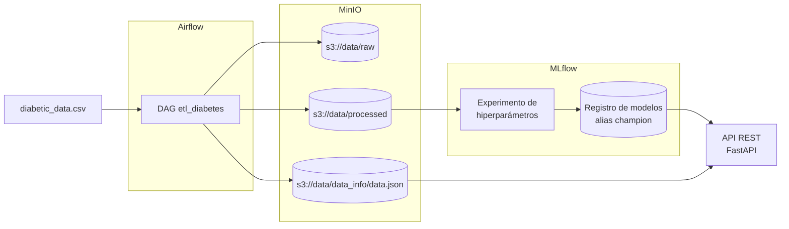

# Reingreso hospitalario de pacientes diabéticos: servicio de ML

Trabajo práctico de Aprendizaje de Máquina II (CEIA, FIUBA).

Integrantes: Carlos, Florencia y Mariano.

Este repositorio parte de [amq2-service-ml](https://github.com/facundolucianna/amq2-service-ml) de Facundo Lucianna, distribuido bajo la licencia incluida en [LICENSE](LICENSE).

## El problema

Un reingreso hospitalario dentro de los 30 días posteriores al alta suele indicar que el tratamiento o el seguimiento no fueron suficientes, y además tiene un costo alto para el sistema de salud. Detectar a tiempo a los pacientes con más riesgo permite reforzar su seguimiento antes del alta.

Usamos el dataset *Diabetes 130-US Hospitals (1999-2008)* de UCI, con unas 100.000 internaciones de pacientes diabéticos. El objetivo es predecir si un paciente vuelve a internarse en menos de 30 días.

El modelo viene del trabajo de Aprendizaje de Máquina I: un Random Forest sobre 18 variables, con un umbral de decisión de 0,14 elegido para priorizar la detección de reingresos. En este trabajo lo llevamos a un servicio que se entrena, se registra y se sirve de forma reproducible.

## Qué hace el servicio



1. **Airflow** orquesta el procesamiento. El DAG `etl_diabetes` carga el CSV original, lo limpia, arma las variables finales, separa train y test agrupando por paciente y guarda todo en MinIO.
2. **MinIO** funciona como almacenamiento de objetos compatible con S3. Guarda los datos crudos, los procesados y `data.json`, que describe las columnas, sus tipos y las categorías válidas.
3. **MLflow** registra el experimento de búsqueda de hiperparámetros y guarda el mejor pipeline en el registro de modelos con el alias `champion`.
4. **FastAPI** sirve el modelo `champion` y valida cada pedido según `data.json`, así el entrenamiento y el servicio usan exactamente las mismas columnas.

## Requisitos

- Docker y Docker Compose v2.
- Al menos 4 GB de memoria asignada a Docker, 2 CPUs y 10 GB libres en disco.
- [uv](https://docs.astral.sh/uv/), solo si se quieren correr los scripts fuera de Docker.

## Instalación y ejecución

1. Clonar el repositorio:

   ```bash
   git clone <url-del-repo>
   cd <carpeta-del-repo>
   ```

2. Solo en Linux: poner el UID del usuario en el archivo `.env`, para que los archivos que crea Airflow queden a su nombre.

   ```bash
   id -u
   ```

   Reemplazar el valor de `AIRFLOW_UID` por el número que devuelve. En macOS y Windows se deja `50000`.

3. Levantar todos los servicios:

   ```bash
   docker compose --profile all up -d
   ```

   La primera vez construye las imágenes y tarda varios minutos.

4. Verificar que los servicios estén en estado `healthy`:

   ```bash
   docker ps -a
   ```

5. Entrar a las interfaces:

   | Servicio | Dirección | Usuario | Contraseña |
   |---|---|---|---|
   | Airflow | http://localhost:8080 | `airflow` | `airflow` |
   | MLflow | http://localhost:5001 | | |
   | MinIO | http://localhost:9001 | `minio` | `minio123` |
   | API | http://localhost:8800/docs | | |

   Las credenciales están en el archivo `.env`.

6. Opcional: crear el entorno local para correr los scripts por fuera de Docker.

   ```bash
   uv sync
   ```

Para detener los servicios:

```bash
docker compose --profile all down
```

Para detenerlos y borrar también los datos (bases de Airflow y MLflow, y el contenido de MinIO):

```bash
docker compose --profile all down -v
```

### Verificar la instalación

El DAG `check_virtualenv` comprueba que todo esté bien configurado antes de correr el pipeline: lee las variables de Airflow, crea entornos virtuales en el worker y escribe y lee un archivo en MinIO.

1. En Airflow, activar `check_virtualenv` con el interruptor de la lista de DAGs.
2. Ejecutarlo con el botón **Trigger**.
3. Si las tres tareas terminan en verde, el entorno está listo.

## Configuración

### Variables y conexiones de Airflow

Las variables y conexiones se definen en `airflow/secrets/`, no en la interfaz de Airflow, para que el sistema quede configurado al clonar el repo:

- `variables.yaml`: rutas en MinIO, parámetros del ETL (semilla, tamaño del test, columna objetivo) y datos de MLflow.
- `connections.yaml`: conexión a MinIO (`aws_default`) y a MLflow (`mlflow_default`).

Airflow las lee con `LocalFilesystemBackend`, por eso no aparecen en *Admin → Variables* ni en *Admin → Connections*. Para consultarlas:

```bash
docker compose exec airflow-scheduler airflow variables get random_seed
docker compose exec airflow-scheduler airflow connections get aws_default
```

`connections.yaml` no lleva credenciales: las de MinIO llegan a los contenedores como variables de entorno desde el `.env`.

### DAGs

Los DAGs se leen directamente desde `airflow/dags/`, porque el `docker-compose.yaml` monta esa carpeta dentro de los contenedores de Airflow. Un DAG nuevo o modificado aparece solo, sin copiarlo ni reiniciar nada. Puede tardar hasta 5 minutos; para forzarlo:

```bash
docker compose exec airflow-dag-processor airflow dags reserialize
```

### Tareas en entorno virtual

Las tareas de los DAGs usan `@task.virtualenv`: cada una corre en un entorno de Python aislado con sus propias dependencias, separado del de Airflow. Esto evita conflictos de versiones, pero tiene dos consecuencias:

- La primera corrida de cada tarea tarda más, porque crea el entorno e instala las dependencias. Las siguientes reutilizan el entorno guardado en `/tmp/venv_cache` dentro del worker.
- Si se recrea el contenedor del worker, se pierde esa caché y la próxima corrida vuelve a tardar.

Airflow crea estos entornos con `uv`. El `docker-compose.yaml` define `UV_CACHE_DIR=/tmp/uv_cache` porque la carpeta de caché que `uv` usa por defecto no es escribible por el usuario de Airflow dentro de la imagen.

## Estructura del repositorio

```
airflow/dags/               DAGs: etl_diabetes, retrain_model
airflow/secrets/            variables.yaml y connections.yaml
batch/                      predicción por lotes con Metaflow y consulta en Valkey
experiments/                búsqueda de hiperparámetros
dockerfiles/                imágenes de Airflow, MLflow, Postgres y FastAPI
dockerfiles/fastapi/files/  copia de respaldo del modelo y de data.json
frontend/                   app de Streamlit
tests/                      pruebas
docs/                       avance y diagramas
data/                       copia de respaldo de diabetic_data.csv
```

## Sistemas en los que se probó

- Ubuntu en WSL2 (Windows), Docker Desktop.
- macOS.


## Estado

Esta es la versión de la entrega parcial. El detalle de lo hecho, lo que falta y cómo seguimos está en [docs/avance.md](docs/avance.md).
